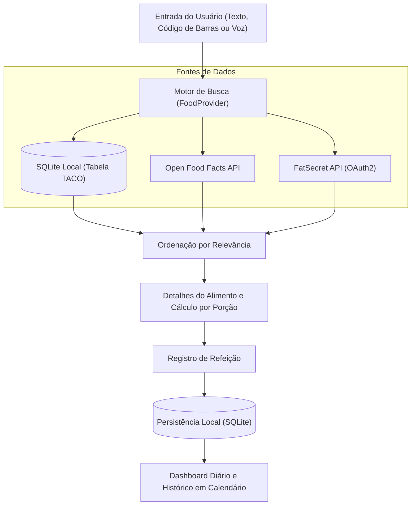

<div align="center">
  
  <h1>MacroCheck</h1>
  <p><strong>Aplicativo mobile em Flutter para consulta nutricional e acompanhamento diário de macronutrientes</strong></p>

  <p>
    
    
    
    
  </p>
</div>

---

## Sobre o Projeto

O **MacroCheck** foi desenvolvido como um projeto prático de estudo para aprofundar conhecimentos em desenvolvimento mobile com **Flutter** e **Dart**. O objetivo foi construir um aplicativo funcional do zero, aplicando conceitos reais como persistência local com SQLite, gerenciamento de estado reativo, consumo de APIs REST com autenticação OAuth2 e leitura de código de barras.

---

## Funcionalidades

- **Busca Nutricional em Múltiplas Fontes:** Pesquisa local offline na Tabela Brasileira de Composição de Alimentos (**TACO**) combinada com fallback online nas APIs **Open Food Facts** e **FatSecret**.
- **Entrada por Texto, Voz e Código de Barras:** Busca digitada, comando de voz (`speech_to_text`) e leitura de código de barras da embalagem (`mobile_scanner`).
- **Cálculo Proporcional de Macros:** Ajuste automático de calorias, proteínas, carboidratos, gorduras e fibras conforme a porção informada em gramas.
- **Diário e Histórico em Calendário:** Registro das refeições do dia com gráficos (`fl_chart`) e consulta de dias anteriores (`table_calendar`).
- **Cadastro Manual de Alimentos:** Possibilidade de registrar alimentos personalizados localmente no banco SQLite do dispositivo.
- **Interface Bilingue:** Suporte a Português (`pt`) e Inglês (`en`).

---

## Fluxo de Funcionamento



---

## Estrutura do Projeto

```text
macrocheck-nutrition-app/
├── assets/
│   ├── db/                  # Base inicial (Tabela TACO e seed JSON)
│   └── images/              # Ícones e ilustrações do app
├── lib/
│   ├── config/              # Templates de configuração de ambiente (.example)
│   ├── l10n/                # Internacionalização (PT / EN)
│   ├── models/              # Modelos de domínio (FoodModel, MealItem)
│   ├── providers/           # Estado com Riverpod (busca, refeições, histórico)
│   ├── screens/             # Telas principais (Home, Detalhes, Histórico, Scanner)
│   ├── services/            # SQLite local e clientes HTTP (Dio, OpenFoodFacts, FatSecret)
│   ├── utils/               # Utilitários de formatação e datas
│   ├── widgets/             # Componentes visuais reutilizáveis (Dashboard, Cards)
│   └── main.dart            # Inicialização e tema Material 3
└── pubspec.yaml             # Dependências e configuração do Flutter
```

---

## Tecnologias Utilizadas

| Categoria | Tecnologia |
| :--- | :--- |
| **Framework & Linguagem** | Flutter 3 / Dart 3 |
| **Gerenciamento de Estado** | `flutter_riverpod` |
| **Banco de Dados Local** | `sqflite` + `sqflite_common_ffi` |
| **Requisições HTTP** | `dio` |
| **Gráficos e Calendário** | `fl_chart`, `table_calendar` |
| **Câmera e Voz** | `mobile_scanner`, `speech_to_text` |

---

## Como Executar Localmente

1. **Clone o repositório:**
   ```bash
   git clone https://github.com/gitbezoomy/macrocheck-nutrition-app.git
   cd macrocheck-nutrition-app
   ```

2. **Instale as dependências:**
   ```bash
   flutter pub get
   ```

3. **Configure os arquivos de ambiente:**
   ```bash
   cp lib/config/env.dart.example lib/config/env.dart
   cp lib/config/secrets.dart.example lib/config/secrets.dart
   ```
   *(A busca offline na Tabela TACO e a consulta via Open Food Facts funcionam mesmo sem chaves da API FatSecret).*

4. **Execute o aplicativo:**
   ```bash
   flutter run
   ```

---

## Aprendizados Praticados

- Modelagem e migração de banco de dados local com **SQLite** no Flutter.
- Organização de código separando ** telas (`screens`)**, **estado (`providers`)**, **regras de acesso a dados (`services`)** e **modelos (`models`)**.
- Tratamento de chamadas assíncronas, paginação, cache local e combinação de resultados offline + online.
- Integração com recursos nativos do aparelho (câmera para leitura de código de barras e microfone para busca por voz).
